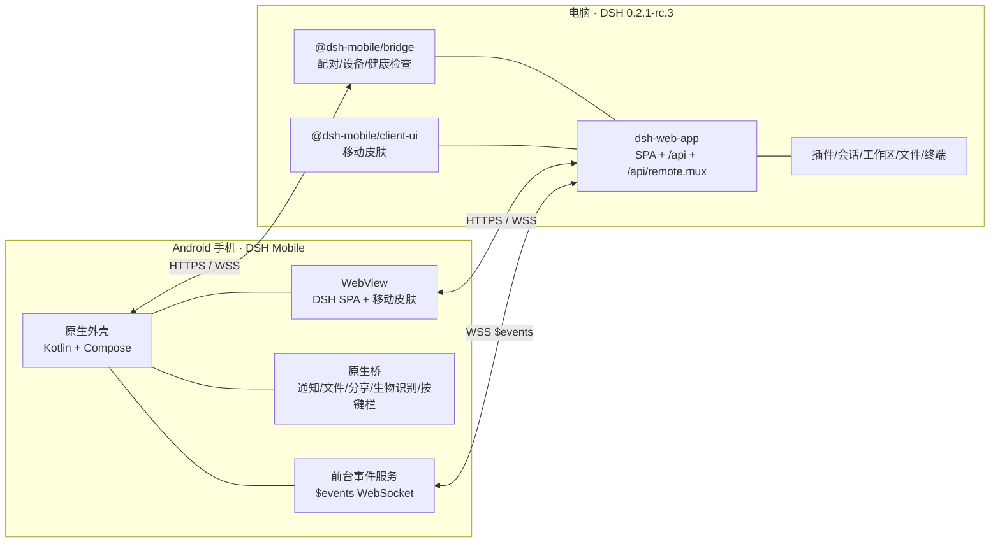
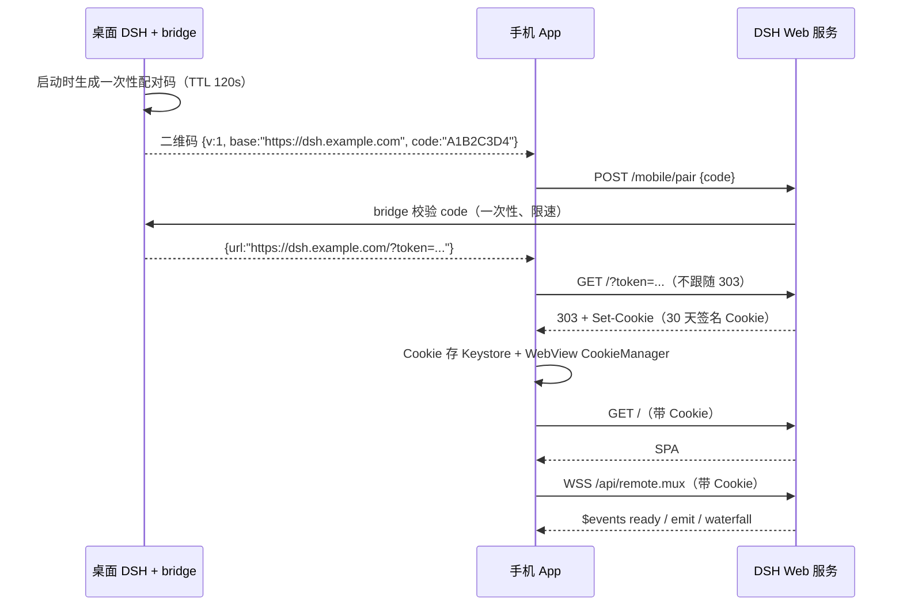

# DSH Mobile 项目计划

> Android 远程控制端 · v0.2（决策已定） · 2026-11-04
> 工作目录：`D:\project\DSH-Mobile`
> 目标 DSH 版本：`0.2.1-rc.3`（本机实测）

---

## 0. 结论（先看这里）

**已定路线：Android 原生外壳 + 复用 DSH 现有 Web 客户端 + 两个 DSH 插件。**

- **不做全原生重写。** 桌面端的聊天流、工具卡片、审批、终端、插件市场、设置页等，全部已经在 Web 客户端里；重写一遍需要 3–6 个月，而且会持续落后于桌面端。
- **Android 端只做“外壳 + 移动皮肤 + 原生能力”**：配对、连接、WebView、前台通知、文件、生物识别、后台事件。
- **桌面端补两个小插件**：
  1. `@dsh-mobile/bridge`：配对码/二维码、公网地址上报、设备管理、健康检查。
  2. `@dsh-mobile/client-ui`：移动端布局皮肤，复用现有 `ctx.layout` 和 `shell.bottom` 插槽。
- **接入**：局域网 / Tailscale / frp + VPS 三路；App 内置三套连接配置与一键切换。
- **不做**：杀进程推送（只用前台服务）、手机端直接编辑文件（只读 + Agent 改）。
- **MVP 约 3–4 周，完整版约 10–11 周（2 人）**。

关键判断：DSH 已经提供了完整的 Web GUI、类型化 Remote API、30 天持久 Cookie；移动端真正缺的只有 **接入/配对、触屏布局、通知/审批、文件与后台** 这四件事。

### 0.1 已确认的五个决策

| # | 决策 | 选择 | 对方案的影响 |
|---|---|---|---|
| 1 | 插件安装 | **A：安装 bridge + client-ui** | 配对二维码、移动皮肤、设备管理、健康检查可用；不做推送和文件写入 |
| 2 | 远程接入 | **局域网 / Tailscale / frp + VPS 三路，App 内切换** | App 需支持多连接配置；内置三种方式的说明和诊断 |
| 3 | UI 形态 | **A：WebView + 移动皮肤** | 功能对等优先；不做全原生重写 |
| 4 | 推送 | **仅前台服务（FGS）** | App 进程存活时可通知；被杀/被强停后不保证，明确接受此限制 |
| 5 | 文件编辑 | **A：只读 + Agent 改** | 不新增写 API；降低安全面；手机端不直接改文件 |

> 结论：范围比 v0.1 收窄了两块（推送、文件写入），因此 M3 从“安全与远程”改为“安全、设备与稳定性”，总工期约 10–11 周。

---

## 1. 目标与非目标

### 1.1 目标

1. 在 Android 手机上远程操控电脑上的同一个 DSH 实例，而不是另起一个实例。
2. 覆盖桌面端大部分高频功能：
   - 会话：列表、切换、新建、重命名、分支、归档、搜索、排队消息。
   - 工作区：切换、创建、重命名、排序、归档。
   - 模型：查看目录、切换会话模型、设置默认模型。
   - 插件：插件列表、启用/禁用、插件市场、安装/卸载（需二次确认）。
   - 代码文件：目录树、文本/图片预览、diff、变更列表、下载/分享、上传附件。
   - 终端：打开会话终端、执行命令、Ctrl/Esc/Tab 等按键。
   - 审批：工具调用审批、权限模式切换。
   - 设置、凭据、定时任务、目标、子代理、技能等。
3. 移动端界面与桌面端“同源、相似”：同一套设计语言、同一套功能入口，按触屏重排。
4. 不在电脑前也能完成任务：完成通知、审批通知、断线重连、桌面重启后仍保持登录。
5. 安全：只允许已配对设备；TLS；设备可撤销；令牌不落明文。

### 1.2 非目标（v1 不做）

- iOS（架构可平移，后续再做）。
- 多用户/团队协作、会话分享。
- 远程桌面/屏幕串流。
- 离线执行任务（手机只是遥控器，推理和执行仍在电脑）。
- 手机端直接编辑代码文件（已确认不做；DSH 当前也没有文件写入 API；见 §4.6）。
- 替代桌面端：复杂插件开发、深度调试仍建议在电脑上做。

---

## 2. 现状调研（基于本机 DSH 0.2.1-rc.3）

### 2.1 可以直接复用的三块资产

| 资产 | 位置/包 | 说明 |
|---|---|---|
| Web GUI | `@deepseek-ai/dsh-web-app` + `dsh-web-frontend` | 完整的浏览器客户端；桌面 Electron 也使用同一套 Web 客户端代码；含聊天、侧栏、文件、终端、插件市场、设置。 |
| Remote API | `@deepseek-ai/dsh-api-gateway` + `dsh-api-*` | 类型化 RPC：`POST /api/<endpoint>`；流式：`WS /api/remote.mux`；事件：`$events`。 |
| 插件体系 | `dsh-plugin-manager` / `dsh-client-modules` | 第三方 Host/Client 插件可安装；Client 插件通过 `dsh.client` 元数据注入浏览器。 |

本机桌面端运行的是 `~/.dsh/profiles/desktop`，已安装 `dshmarket`、`dsh-fairy-zzz`、`dsh-ops` 等第三方插件，说明第三方插件安装链路是通的。

### 2.2 认证与接入事实（决定架构的关键）

| 事实 | 细节 | 影响 |
|---|---|---|
| 启动令牌 | 每个 DSH 进程随机生成一个 launch token，`dsh web` 打印带 `?token=` 的 URL | 不能把 token 写死；需要配对流程 |
| 浏览器 Cookie | `GET /?token=...` → `303` + 签名 Cookie；默认 30 天 | **配对一次可用 30 天** |
| Cookie 持久性 | 签名密钥保存在 `$DSH_HOME/.credentials.yaml`，进程重启后复用 | **桌面重启后 Cookie 仍有效** |
| API Cookie | `GET /connect?token=...&interactions=answer\|none` → API Peer + Cookie | 适合“一次性 API 客户端”；建立 socket 后 Peer 与该 socket 绑定；App 优先用浏览器 Cookie |
| Host/Origin 校验 | Host 必须是回环、监听绑定 IP，或在 `trustedHosts` 中；跨站 Origin 拒绝 | 公网访问必须配置 `trustedHosts` 或由反向代理改写 Host |
| 监听地址 | `--host` 只接受一个具体 IP，拒绝 `0.0.0.0` | 公网/局域网接入需要反向代理或具体网卡 IP |
| 文件写入 | `workspaceFiles` 只有 `list/read/readBytes/stat/changes`，**没有写操作** | 手机端直接编辑文件需要新增 Host API；**已确认不做** |
| 移动布局 | 仅 `<1024px` 自动折叠侧栏；没有 safe-area、粗指针、触屏专用布局 | 需要移动皮肤插件 |
| 端口 | DSH 固定 `127.0.0.1:53985`；M3 设备代理 `127.0.0.1:53986` | Tailscale Serve 指向 53986，由代理校验设备令牌后转发到 53985 |

### 2.3 现有能力的边界

- **能做**：会话/工作区/模型/插件/文件/终端/审批/设置/定时任务/目标/子代理/技能，全部有 Remote 端点或 UI。
- **不能做**：文件写入、系统级推送、稳定的配对 UI、移动端专用布局。
- **需要补**：配对页、移动皮肤、通知/审批桥、公网接入说明。

---

## 3. 方案对比与决策

### 3.1 四种路线

| 方案 | 功能对等 | 首版工期 | 体验 | 维护成本 | 结论 |
|---|---|---|---|---|---|
| A. 纯 PWA | 100% | 1 天 | 桌面布局挤在手机上；无原生通知/文件集成 | 极低 | 仅用于 M0 验证 |
| B. WebView 外壳 + 移动皮肤 | ~100% | 3–4 周 | 好；接近桌面 | 低 | **已选** |
| C. 全原生 Compose | 60–80% | 3–6 个月 | 最佳 | 高；每个桌面功能都要重写 | 未选 |
| D. B + 原生关键页 | 100% | 6–8 周 | 很好 | 中 | 后续按需演进 |

### 3.2 推荐架构



### 3.3 为什么复用 Web 客户端

1. **功能对等是免费的**：桌面端每加一个功能，手机端自动获得。
2. **协议正确性**：会话日志、assistant 流、工具卡片、审批瀑布、终端 xterm 的细节都在客户端里；自己实现极易漏掉边界情况。
3. **UI 相似是天然的**：同一套组件、同一套主题、同一套布局，只是按屏幕宽度重排。
4. **风险可控**：移动皮肤是 CSS + 少量 React；不改 DSH 核心。

### 3.4 为什么还需要两个插件

- **没有 bridge 插件**：拿不到当前进程的 token，无法生成可扫描的配对二维码；桌面重启后端口变化也无法上报。
- **没有移动皮肤**：桌面三栏布局在 390px 宽度下不可用；`shell.bottom` 插槽和 `ctx.layout` 是官方扩展点，适合做底部标签栏/抽屉。
- 两个插件都很小，可独立升级，不阻塞 App 发版。

---

## 4. 系统设计

### 4.1 组件职责

| 组件 | 技术 | 职责 |
|---|---|---|
| `android/` | Kotlin 2.x、Compose、OkHttp、kotlinx.serialization | 配对、连接管理、WebView、Cookie、通知、文件、生物识别、诊断 |
| `@dsh-mobile/bridge` | TypeScript/ESM、Cordis Host 插件 | 配对码/二维码、公网地址、设备列表、健康检查；**不做推送** |
| `@dsh-mobile/client-ui` | React、Cordis Client 插件 | 移动皮肤、底部标签栏、抽屉、安全区、深链、终端按键栏 |
| DSH 本体 | 0.2.1-rc.3 | 会话/工作区/文件/终端/插件/模型/审批 |

### 4.2 配对与认证时序



要点：

- 二维码里**不放 launch token**，只放一次性 code；token 通过 TLS 换取。
- 换取成功后，App 同时拿到浏览器 Cookie；后续 HTTP/WS 都用它。
- Cookie 30 天有效，桌面重启后仍有效；过期或 401 时重新配对。
- 撤销：删除 `$DSH_HOME/.credentials.yaml` 里的 `client-connection/browser-session` 记录并重启（全局撤销），或由 bridge 的设备列表撤销（后续）。

### 4.3 远程接入方案

**运行前提**：电脑必须保持开机、DSH 桌面端保持运行（可最小化到托盘），网络可达。关闭 DSH 或电脑休眠后，手机端只能看到离线状态；后续可选 Wake-on-LAN。

| 方案 | 适用 | 优点 | 缺点 | 决策 |
|---|---|---|---|---|
| **Tailscale** | 个人首选 | 私有 WireGuard、无需公网 IP、Android 客户端成熟、MagicDNS 稳定 | 国内控制面偶尔慢；需要两端安装 | **主用（已定）** |
| **frp + VPS** | 国内稳定 | 完全自控、可 TLS、可限流 | 需要 VPS 和运维 | **备用（已定）** |
| **Cloudflare Tunnel** | 快速试用 | 零公网 IP、自带 TLS/Access | 国内可能被阻断；依赖 Cloudflare | 未选 |
| **局域网直连** | 同 Wi-Fi | 延迟最低 | 只能在家；明文 HTTP | **同网段首选** |

**已定策略**：局域网（同 Wi-Fi 首选）、Tailscale（远程主用）、frp + VPS（兜底）三路并存；App 内保存三套连接配置，可一键切换，并内置三种方式的配置说明、诊断和常见问题。

#### App 内的接入说明（必须实现）

App 的“连接管理”页需要包含：

1. **局域网向导**：电脑查 LAN IP → DSH `webserver.host` 绑定该 IP（不能 `0.0.0.0`）→ 防火墙放行 53985 → 填入 `http://<ip>:53985` → 测试。
2. **Tailscale 向导**：安装 Tailscale → 登录同一 tailnet → 电脑执行 `tailscale serve` → 填入 MagicDNS 地址 → 测试。
3. **frp 向导**：VPS 安装 frps → 电脑配置 frpc → nginx TLS + `proxy_set_header Host $host` → 填入域名 → 测试。
4. **诊断**：DNS 解析、TCP 连接、TLS 证书、HTTP 状态（200/401/403）、WebSocket 握手、Cookie 是否过期。
5. **切换**：三套配置分别配对；切换后 WebView 重新加载，Cookie 按 Host 自动匹配；失败时提示切到另一套。
6. **常见错误**：403 是 Host 未信任；401 是 Cookie 过期；超时是隧道/防火墙；WebSocket 失败是反代未升级连接；`unknown-base` 是 bridge `endpoints` 没列该地址。
7. **安全提示**：不要把 53985 直接暴露公网；frp 必须 TLS + token/IP 白名单；配对页只允许本机访问。

#### Tailscale 参考配置

```powershell
# 电脑和手机都登录同一 tailnet
tailscale up
# 把本地 53985 暴露到 tailnet（HTTPS）；具体参数以当前 Tailscale 版本为准
tailscale serve --bg --https=443 http://127.0.0.1:53985
# 手机打开 https://<machine>.<tailnet>.ts.net/
```

如果 Tailscale Serve 保留了原始 Host，需要在 DSH 配置里信任该域名：

```yaml
# ~/.dsh/profiles/desktop/cordis.patch.yml
- id: connection
  config:
    trustedHosts: ['<machine>.<tailnet>.ts.net']
```

#### frp + nginx 参考配置

```ini
# frpc.ini（TLS 由 VPS 上的 nginx 终止）
[web]
type = tcp
local_ip = 127.0.0.1
local_port = 53985
remote_port = 15385
```

```nginx
location / {
    proxy_pass http://127.0.0.1:15385;
    proxy_set_header Host 127.0.0.1:53985;   # 让 DSH 的 Host 校验通过
    proxy_http_version 1.1;
    proxy_set_header Upgrade $http_upgrade;
    proxy_set_header Connection "upgrade";
    proxy_read_timeout 3600s;
}
```

#### 端口固定

桌面端 Web 端口实测为 `53985`，但可能随启动变化。建议在 profile patch 中固定：

```yaml
- id: webserver
  config:
    host: 127.0.0.1
    port: 53985
    compression: gzip
    compressionLevel: 1
    compressionThresholdBytes: 1024
```

> 注意：patch 会**整体替换**该行的 `config`，所以要把原有键一起写全。
> 如果桌面宿主强制覆盖端口，则由 bridge 插件把实际端口写入 `pairing.json`，隧道脚本读取后转发。

### 4.4 移动端 UI

#### 4.4.1 策略：移动皮肤，而不是重写

复用现有 `dsh-client-ui-layout` 的三栏框架和 `ctx.layout` 服务，只做三件事：

1. **CSS 重排**：`@media (max-width: 768px)` 下把侧栏变成抽屉、右栏变成全屏 Sheet、输入框贴底、隐藏桌面 resize handle。
2. **`shell.bottom` 底部标签栏**：Chat / 会话 / 文件 / 终端 / 更多；调用 `ctx.layout.toggleSidebar()`、`ctx.layout.selectPanel()`、`ctx.layout.openRightbar(track, true)`。
3. **`shell.overlay` 抽屉/遮罩**：会话和工作区列表从左侧滑出；打开时自动把 DSH 的折叠 rail 展开为带文字的完整侧栏，点击图标不会收起抽屉；抽屉右缘的 `×` 或遮罩负责关闭，关闭时恢复 rail。

关键 CSS 变量：

```css
:root {
  --dsh-mobile-tabbar-height: 56px;
  --dsh-mobile-safe-bottom: env(safe-area-inset-bottom, 0px);
  --dsh-mobile-safe-top: env(safe-area-inset-top, 0px);
}
```

触屏细节：

- 所有可点区域 ≥ 44dp；禁用 hover-only 交互。
- 输入框 `font-size: 16px`，避免 iOS/Android 自动放大。
- `viewport-fit=cover` + 安全区 padding。
- 终端：原生按键栏（Esc/Tab/Ctrl/Alt/↑↓←→）注入 `keydown`；`windowSoftInputMode=adjustResize`。
- 长按菜单、复制粘贴、图片预览保持 WebView 原生能力。
- 横屏：紧凑图标底栏、终端按键栏变矮、旋转不重建 WebView；**平板适配按用户要求跳过**。

#### 4.4.2 深链与通知跳转

DSH SPA 没有 URL 路由，`/` 始终是唯一页面，因此深链不能靠改 URL，必须调用 DSH 自己的 `uiWorkspace.openSession(sessionId)`。

实现：

- `@dsh-mobile/client-ui` 用 `ctx.inject(['uiWorkspace'])` 等待服务就绪，暴露
  `window.__DSH_MOBILE_OPEN_SESSION__(sessionId)`；服务未就绪时返回 `false`，不抛异常。
- 通知/深链统一使用 DSH 的**完整会话 ID**（形如 `session-<uuid>`），不要再手工去掉 `session-` 前缀。
- `MainActivity` 声明 `launchMode="singleTop"`，`onNewIntent` 更新待打开 ID；支持：
  - extra `session_id`
  - URI `dshmobile://session/<session-id>`
- WebView 侧最长等待 60 秒（Tailscale 冷启动插件包可能 20–30 秒），桥就绪后调用 `openSession`；失败提示“未能定位到目标会话，请手动打开”。

```js
// client-ui 暴露的桥（实际签名）
window.__DSH_MOBILE_OPEN_SESSION__(sessionId): boolean
```

没有插件或桥未就绪时，App 退化为“打开 App，用户手动点会话”。

#### 4.4.3 文件、相机、剪贴板与主题

| 能力 | 实现 |
|---|---|
| 文件选择/上传 | `WebChromeClient.onShowFileChooser` → `ACTION_OPEN_DOCUMENT`，支持多选；结果回填 WebView |
| 拍照上传 | 同一 chooser 附带 `MediaStore.ACTION_IMAGE_CAPTURE` + `EXTRA_OUTPUT`；`FileProvider` 临时 URI；运行时申请 `CAMERA` |
| 下载保存 | `DownloadListener` 交给系统 `DownloadManager`，API 29+ 写入公共 `Download/` |
| 下载完成通知 | `DownloadCompleteReceiver` 监听 `DOWNLOAD_COMPLETE`，只对成功项发通知，提供“打开 / 分享” |
| 分享 | 通知 action `ACTION_SEND`，`FileProvider` 授权临时读 |
| 剪贴板图片 | 原生底栏“粘贴”读取 `ClipboardManager` 图片 → 缩放/JPEG/Base64 → WebView 构造 `File` + 合成 `ClipboardEvent('paste')` |
| 主题 | Compose `isSystemInDarkTheme()` 同步状态栏/导航栏图标、WebView 背景色；DSH 自身 `body[data-ds-dark-theme]` 跟随系统 |

> 语音输入按用户要求不做。平板适配按用户要求跳过。

#### 4.4.4 原生外壳界面

| 页面 | 内容 |
|---|---|
| 启动/连接 | Logo、连接状态、重试、诊断入口 |
| 配对 | 扫码（ZXing，避免 GMS 依赖）、粘贴 URL、手动输入 code |
| 主界面 | 全屏 WebView + 连接状态浮层 |
| 设置 | 通知、生物识别锁、连接管理、Cookie 到期、清除配对、关于 |
| 诊断 | 版本、延迟、TLS、Cookie 有效期、最近错误、导出日志 |

### 4.5 通知与审批

#### 事件来源

原生前台服务打开 `WSS /api/remote.mux`，发送：

```json
{"type":"open","streamId":"<uuid>","endpoint":"$events","payload":{}}
```

第一条 `item` 是：

```json
{"type":"ready","clientId":"...","host":{"home":"C:\\Users\\..."}}
```

后续帧：

```json
{"type":"emit","event":"api-session/status","args":[...]}
{"type":"waterfall","event":"approval/request","eventId":"...","agentId":"...","request":{...}}
{"type":"cancel","eventId":"..."}
```

#### 通知策略

| 事件 | 通知 | 动作 |
|---|---|---|
| `api-session/status` 从 running → idle | “任务完成” | 打开会话 |
| `approval/request` | 高优先级“需要审批” | 打开会话，由 SPA 审批 |
| `api-session/error` | “任务出错” | 打开会话 |
| `job/settled` | “后台任务结束” | 打开任务面板 |

**已定：只做前台服务，不做杀进程推送，也不做原生 Allow/Deny。** 通知只负责“提醒 + 打开 App”，审批仍在 SPA 里完成；不实现 `$events/result` 的原生审批回传。

#### 后台限制（已接受）

- Android 14+ 前台服务需要声明类型；用 `dataSync`，并在设置里提供“后台保持连接”开关。
- Android 15 对 `dataSync` 前台服务有时长限制（约 6 小时/24 小时，具体以官方文档为准）；长时间后台需要用户重新打开 App。
- 息屏/Doze/国产 ROM 可能断连；重连策略：指数退避 + 网络变化监听。
- **App 被杀、被强停、或前台服务被系统回收后，不保证收到通知。** 设置页要明确写出这一限制，避免用户误以为这是系统级推送。

### 4.6 功能映射

| 功能 | 实现方式 | 端点/组件 |
|---|---|---|
| 会话列表/切换/新建/重命名/分支/归档/搜索 | SPA | `session/list`、`session/create`、`session/fork`、`session/rename`、`session/search` |
| 会话历史/流式回复 | SPA | `session/follow`、`session/page`、`session/projections` |
| 发送/排队/取消 | SPA | `session/prompt`、`session/cancel`、`session/updateQueue` |
| 工作区切换/创建/重命名/排序 | SPA | `workspace/*` |
| 模型选择 | SPA | `session/modelCatalog`、`session/selectModel`、`model/selection` |
| 插件管理/市场 | SPA | `pluginManager/*`、`pluginMarket/*`、`pluginInventory/list` |
| 文件浏览/预览/diff/下载 | SPA | `workspaceFiles/list|read|readBytes|stat|changes`、`GET /api/file?path=` |
| 文件上传/拍照 | 原生文件选择 + SPA | `fileUploads/upload` |
| 代码编辑 | **已确认不做直接编辑**；只读 + 通过对话让 Agent 改 | 不新增 Host API |
| 终端 | SPA（xterm）+ 原生按键栏 | `terminal/*` |
| 审批 | SPA + 原生通知 | `approval/request` 瀑布 |
| 权限模式 | SPA | `permission/preset`、`permissionPresets/catalog` |
| 设置/凭据 | SPA | `settings/*`、`credentials/*` |
| 定时任务/目标/子代理 | SPA | `schedule/*`、`goals/*`、`subagent` 事件 |
| 语音输入 | SPA + Android 麦克风权限 | `experimental-speech-to-text` |
| 通知 | 原生前台服务 | `$events` |
| 配对 | bridge 插件 | `POST /mobile/pair` |

> **文件写入的说明**：`workspaceFiles` 明确“exposes no mutation operation”。**已确认不新增 `mobileFiles/write`**；手机端只做查看/下载/让 Agent 修改。这样避免路径穿越、符号链接、并发写、备份/撤销等高权限风险。若未来确实需要，再单独立项评估。

### 4.7 安全模型

| 层 | 措施 |
|---|---|
| 传输 | 只允许 HTTPS/WSS；局域网明文仅调试开关；证书固定（可选） |
| 配对 | 一次性 code，TTL 120s，限速；二维码不含 launch token；配对页仅本机可开 |
| 存储 | Cookie/设备密钥存 Android Keystore + EncryptedSharedPreferences；不写日志 |
| 设备 | 设备列表、命名、撤销；撤销后删除服务端记录并重启 DSH |
| App | 生物识别锁、切后台超时锁、截屏保护（可选） |
| 审批 | 默认 `ask`；危险工具（bash/写文件/插件安装）在手机上二次确认；可配置“仅桌面审批” |
| 网络 | Tailscale ACL / frp token + IP 白名单 / Cloudflare Access；不要把 53985 直接暴露公网 |
| 审计 | bridge 记录配对、撤销、远程审批；App 保留最近 200 条操作日志 |

### 4.8 兼容性

- DSH 版本锁定 `0.2.1-rc.3`；bridge 与 client-ui 的 `peerDependencies` 也锁定。
- App 启动时调用 `GET /mobile/hello`（bridge 提供），返回 DSH 版本、插件版本、能力位；不兼容时提示升级。
- 移动皮肤依赖 DOM class 时，加 `data-dsh-mobile` 命名空间，避免和桌面样式冲突；每个 DSH 版本做一次视觉回归。

---

## 5. API 与协议速查

### 5.1 认证

```http
GET /?token=<launch-token> HTTP/1.1
Host: dsh.example.com

HTTP/1.1 303 See Other
Location: ./
Set-Cookie: <authority-bound-name>=<signed-value>; Path=/; HttpOnly; SameSite=Strict; Max-Age=2592000
```

后续请求带 `Cookie: <name>=<value>`。

### 5.2 一元 RPC

```http
POST /api/session/list HTTP/1.1
Content-Type: application/json
Cookie: ...

{"type":"client-request","rpcId":"<uuid>","method":"session/list","payload":{}}
```

响应：

```json
{"type":"server-response","rpcId":"<uuid>","result":{"ok":true,"value":{...}}}
```

错误：

```json
{"type":"server-response","rpcId":"<uuid>","result":{"ok":false,"error":{"code":"...","message":"...","details":{}}}}
```

### 5.3 流式 mux

`WSS /api/remote.mux`，客户端帧：

```json
{"type":"open","streamId":"<uuid>","endpoint":"session/follow","payload":{...}}
{"type":"item","streamId":"<uuid>","value":{...}}
{"type":"end","streamId":"<uuid>"}
{"type":"cancel","streamId":"<uuid>"}
```

服务端帧：

```json
{"type":"item","streamId":"<uuid>","value":{...}}
{"type":"end","streamId":"<uuid>"}
{"type":"error","streamId":"<uuid>","error":{"code":"...","message":"...","details":{}}}
```

服务端每 2 秒发 WebSocket Ping；OkHttp 自动 Pong，不需要业务层心跳。

### 5.4 `$events`

- `open` 的 `endpoint` 为 `$events`，`payload` 为 `{}`。
- 第一条 `item` 是 `{type:'ready', clientId, host}`。
- `emit` / `waterfall` / `cancel` 见 §4.5。
- 审批结果通过 `POST /api/$events/result` 回传（v2 实现）。

### 5.5 常见错误码

| code | 含义 | 处理 |
|---|---|---|
| `gateway/input-invalid` | 参数不合法 | 检查字段 |
| `gateway/lookup-not-found` | 会话/工作区不存在 | 刷新列表 |
| `gateway/cancelled` | 调用被取消 | 忽略 |
| `remote-access/denied` | 权限不足 | 检查设备角色/策略 |
| `session/model-unavailable` | 模型不可用 | 重新拉模型目录 |
| `session/conflict` | 会话目录冲突 | 提示用户 |
| `session/writer-held` | 会话被其他写入者占用 | 重试/提示 |

---

## 6. 里程碑

> 假设：1 名 Android 工程师 + 1 名前端/DSH 插件工程师；如果单人，时间 ×1.5–2。

### M0 · 技术验证（第 1 周）

**目标**：证明“手机能安全地调用桌面 DSH 的 API 和 Web UI”。

任务清单：

- [x] bridge 插件：启动时把 `ctx.connection.authenticatedUrl()` 写入 `pairing.json`，并提供 `/mobile/pair`、`/mobile/hello`。
- [x] 用 Node 脚本完成 `token → Cookie → session/list`（2026-11-04 实测 5 个会话）。
- [x] 用 Tailscale（或 frp）从手机访问桌面 `http://127.0.0.1:53985`。
- [x] 解决 Host 校验：`trustedHosts` 或反代改写 Host。
- [x] 用 `websocat`/Node 打开 `$events`，确认能收到 `api-session/status`（实测收到 `ready`；帧字段为 `value`，并已修正前台服务解析）。
- [x] 手机 Chrome 打开 SPA，确认登录、会话、输入、文件预览可用。
- [ ] 桌面重启后，旧 Cookie 仍可用（验证 30 天持久性）。
- [x] 记录实际端口、Host 校验行为、WebSocket 是否被代理缓冲。

**已完成**：bridge 插件、单元测试（14 个，含多 endpoint 二维码、本机配对页限制、反代拒绝、base 选择）、配对/认证/RPC 冒烟测试。  
**实测**：`tailscale serve --bg http://127.0.0.1:53985` + `trustedHosts: hamster.tail52bb47.ts.net`；DSH Mobile 通过 Tailscale 完成配对、进入会话、加载 Fairy 皮肤。`$events` 用修正后的 `payload.args` 订阅成功，收到 `{"type":"item","value":{"type":"ready"}}`。
**交付**：`docs/m0-setup.md`、`docs/protocol-notes.md`；`docs/spike-report.md` 待补。

**验收**：手机在 4G 下能打开会话并收到一次模型回复。（已实际使用 Tailscale 完成）

### M1 · MVP（第 2–4 周）

**目标**：一个可日常使用的 Android App。

- [x] Android 工程：Compose、OkHttp、WebView、ZXing（Keystore 留到 M3）。
- [x] 配对：扫码/手动输入 → 换 Cookie → 存 Cookie。
- [x] 连接管理（基础）：局域网 / Tailscale / frp 三套配置、添加/编辑/删除/测试/一键切换；健康检查、401 重配、前台服务随连接切换（真机待验收）。
- [x] 连接诊断向导：DNS / TCP / TLS / HTTP 状态 / WebSocket / Cookie 全链路诊断与修复建议。
- [x] WebView：Cookie 注入、文件选择、下载、外链、返回键、软键盘；已修复 WebView 高度、Fairy 遮挡、模型菜单和 DSH 对话框的 `100vh=0` 问题。
- [ ] 原生设置：通知、生物识别、清除配对、诊断（通知/清除配对/诊断入口已有；生物识别待补）。
- [x] 前台服务：`$events` → 审批/错误通知（完成态通知待 M2）。
- [x] CSS 移动适配（基础版）：隐藏滚动条、输入框 16px、安全区；完整移动皮肤在 M2。
- [x] bridge 插件 v0：写 `pairing.json`、`/mobile/pair`（含二维码）、`/mobile/hello`。
- [x] 桌面安装/配置文档。

**当前状态（2026-11-05）**：Android 工程已用 JDK 17 构建通过并安装到真机；Tailscale 配对、WebView 会话、Fairy 皮肤、模型菜单、DSH 设置/添加工作区均已实测。连接诊断真机 8/8 通过；**27 个 JVM 单元测试 + 22 个 bridge Node 测试通过**（含设备令牌、代理 HTTP/WebSocket 门禁）。前台服务 `$events` 已收到 `ready`；Read Only 会话触发 `waterfall approval/request`，通知栏已收到「需要审批」。文件选择/上传/下载由用户真机确认通过；本轮补齐文件选择缓存暂存（修复 content URI 授权过期导致的上传失败）、拍照、剪贴板图片、下载完成通知、通知深链和亮/暗主题。`@dsh-mobile/client-ui` 修复移动端中栏 0px 命中区、折叠右栏遮挡和全屏 Sheet；语音输入、平板适配按用户要求不做。M1 剩余：一次完整 10 任务流程；LAN/frp 第二条链路已由用户决定舍弃。

**验收**：在手机上完成 10 个真实任务（新建会话、切工作区、换模型、看文件、开终端、装/禁插件、审批），全程不碰电脑。

### M2 · 移动体验（第 5–7 周）

**目标**：从“能用”到“好用”。

- [x] 原生底部导航：会话 / 文件 / 终端 / 设置（M2 第一增量，已真机验证）。
- [x] `@dsh-mobile/client-ui` CSS 基础皮肤：全宽会话列、header/composer 留白、隐藏 turn rail、加大菜单触控、移动宽度标记；已热加载到真机。
- [x] `@dsh-mobile/client-ui` 完整布局 v1：左边缘抽屉、文件/终端全屏 Sheet、安全区细节；抽屉展开 DSH 完整侧栏并显示图标文字，右缘 `×` 关闭。
- [x] 终端按键栏（Esc/Tab/Enter/Ctrl/Alt/Ctrl+C/方向键，已接入原生底栏）。
- [x] 深链：通知点开直达会话（`singleTop` + `session_id` / `dshmobile://session/<id>` + `uiWorkspace.openSession` 桥）。
- [x] 文件分享/保存、拍照上传、剪贴板图片（下载完成通知含“打开/分享”）。
- [x] 文件/终端面板：`sidebarRight.openTab()` 桥 + `data-sidebar-right-open` 可见性判断，修复全屏面板被折叠右栏样式隐藏。
- [x] 断线重连 UI、离线提示、请求超时（系统网络回调 + `/mobile/hello` 5 秒健康探测，实测飞行模式显示、恢复后消失）。
- [x] 横屏适配：紧凑图标底栏、终端按键栏变矮、Activity 旋转不重建 WebView。
- [x] 主题细节：系统亮/暗切换同步状态栏/导航栏图标、WebView 背景色，DSH 主题跟随系统。
- [ ] 语音输入（用户明确不做）。
- [ ] 平板适配（用户明确不做）。

**验收**：用户已完成一次 30 分钟真实编码任务验收（读文件、改代码、跑测试、审批），本轮按用户要求跳过重复验收。

### M3 · 安全、设备与稳定性（第 8–9 周）

**目标**：可长期远程使用。

- [x] bridge 设备令牌：配对签发独立 deviceToken、Android Keystore 加密保存、`/mobile/token/exchange` 静默续期。
- [x] bridge 设备管理：`/mobile/devices` 列表、命名、撤销；`53986` 设备代理对 HTTP/WebSocket 做即时门禁；App 设置页设备管理。
- [ ] bridge 审计日志：记录配对/撤销/续期操作（当前 devices.json 保留 revokedAt 审计字段）。
- [ ] 连接配置管理增强：三路配置导入/导出、自动诊断向导、切换失败自动回退。
- [ ] 前台服务稳定性：Doze/断网重连、电量优化、Android 15 时长限制提示。
- [ ] 证书固定、生物识别锁、截屏保护。
- [ ] 审批策略：危险工具二次确认、仅桌面审批开关。
- [ ] 多设备、日志导出。
- [ ] 安全评审 + 渗透测试清单。

**验收**：撤销设备后下一次 HTTP/WebSocket 请求立即失效（设备代理已实测 401）；前台服务连续 8 小时可恢复；App 存活时审批通知 10 秒内到达；设置页明确“杀进程后无通知”。

### M4 · 发布（第 10–11 周）

- [ ] CI：lint、单测、instrumented test、assembleRelease。
- [ ] 签名、版本号、更新日志、隐私说明。
- [ ] 安装包/下载页、桌面配置向导、FAQ。
- [ ] 崩溃上报（可选，注意隐私）。
- [ ] Beta 用户反馈、性能/电量优化。

**总工期**：2 人约 10–11 周；单人约 14–16 周。

### 最快路径（今天就能用）

1. 电脑/手机装 Tailscale。
2. `tailscale serve --bg --https=443 http://127.0.0.1:53985`。
3. 在 `cordis.patch.yml` 加 `trustedHosts`（如果 Host 被保留）。
4. 手机浏览器打开 `https://<machine>.<tailnet>.ts.net/`，用桌面端同款 token 登录。
5. “添加到主屏幕”当 PWA 用。

这一步不写代码，先验证网络、认证、UI 可用性，再决定投入。

---

## 7. 仓库结构

```
DSH-Mobile/
├─ android/                     # Gradle 工程
│  ├─ app/
│  │  ├─ src/main/java/...      # Compose、WebView、网络、通知
│  │  └─ src/test/              # 单测
│  ├─ build.gradle.kts
│  └─ settings.gradle.kts
├─ packages/
│  ├─ bridge/                   # @dsh-mobile/bridge（Host 插件，M0 已实现）
│  │  ├─ src/index.js
│  │  ├─ test/bridge.test.js
│  │  └─ package.json
│  └─ client-ui/                # @dsh-mobile/client-ui（Client 插件，M2）
│     ├─ src/client/index.tsx
│     ├─ src/client/mobile.css
│     └─ package.json
├─ docs/
│  ├─ m0-setup.md               # M0 安装/验证
│  ├─ protocol-notes.md         # 抓包/协议补充
│  ├─ desktop-setup.md          # 桌面配置向导
│  └─ spike-report.md           # M0 结论
├─ tools/
│  ├─ smoke-auth.mjs            # 配对 -> Cookie -> session/list
│  ├─ install-m0.ps1            # 安装 bridge 到 desktop profile
│  └─ mock-dsh/                 # Node mock host，供 App 测试
├─ pnpm-workspace.yaml
└─ README.md
```

---

## 8. 测试与验收

### 8.1 自动化

- **协议单测**：RPC envelope、mux 帧、`$events` 帧、Cookie 解析。
- **Mock Host**：Node 实现 `/mobile/pair`、`/?token=`、`/api/session/list`、`/api/remote.mux`，可脚本化发送事件。
- **Android 单测**：Cookie 存储、重连退避、通知路由、深链解析。
- **Instrumented**：WebView 加载 mock SPA、文件选择、通知权限。
- **插件单测**：bridge 的 code TTL/限速；client-ui 的 CSS 快照。

### 8.2 手工 E2E 清单

1. 扫码配对 → 打开会话 → 发消息 → 收到流式回复。
2. 切工作区 → 新建会话 → 换模型 → 发消息。
3. 打开文件 → 预览代码 → 看 diff → 下载/分享。
4. 打开终端 → 执行 `git status` → Ctrl+C。
5. 触发审批 → 手机通知（App 存活）→ 允许/拒绝。
6. 桌面重启 → App 自动重连，无需重配。
7. 手机切 4G/Wi-Fi → 自动重连。
8. 撤销设备 → App 401 → 重新配对。
9. App 被杀 → 重开 App 能恢复连接（**不要求通知**）。
10. 生物识别锁 → 切后台 5 分钟 → 回来要解锁。

### 8.3 性能/电量

- 冷启动 < 2s；WebView 首屏 < 3s（局域网）。
- 重连 < 5s；通知延迟 < 2s（局域网）/ < 5s（4G）。
- 前台服务空闲电量 < 5%/小时；提供“省电模式”（降低 WS 心跳/断线轮询）。

### 8.4 安全测试

- 未配对设备无法调用 `/api`。
- 过期/伪造 Cookie 返回 401。
- Host/Origin 伪造被 403。
- 二维码重放失败（code 一次性）。
- 日志/崩溃报告不含 token/cookie。
- 撤销后旧 Cookie 失效。
- 中间人（自签证书）被拒绝（除非用户显式信任）。

---

## 9. 风险登记

| 风险 | 概率 | 影响 | 对策 |
|---|---|---|---|
| DSH rc 版本 API/UI 变动 | 高 | 中 | 锁定 0.2.1-rc.3；`/mobile/hello` 版本握手；移动皮肤加命名空间；视觉回归 |
| 桌面端口/令牌动态 | 高 | 中 | bridge 上报端口；固定 `webserver.port`；配对码换 token |
| Host/Origin 校验导致 403 | 高 | 高 | M0 验证三种接入；优先反代改写 Host；文档写清 |
| Tailscale 在国内不稳定 | 中 | 中 | frp + VPS 备选；App 支持多配置切换 |
| WebView 性能/兼容 | 中 | 中 | 长会话压测；必要时原生聊天页（方案 D） |
| Android 后台被杀 | 高 | 中 | 前台服务 + 电池白名单；**已确认不做推送**，设置页明确“杀进程后无通知” |
| 审批在手机离线时卡住 | 中 | 高 | 审批策略/超时；保留桌面审批；危险工具仅桌面 |
| 插件 API 不稳定 | 中 | 中 | 移动皮肤只依赖 `ctx.layout`/`shell.bottom` 稳定面；CSS 兜底 |
| 文件不能直接编辑 | — | 低 | **已确认范围约束**：只读 + 让 Agent 改；不新增写 API |
| 安全暴露 | 中 | 高 | 私有网络/TLS/设备撤销/生物识别/审计；不暴露 53985 |
| 电脑休眠/断网 | 高 | 高 | 电源计划；Wake-on-LAN（可选）；App 显示离线原因 |
| 插件安装需要桌面操作 | 中 | 低 | 提供一键安装脚本/文档；后续 bridge 自更新 |

---

## 10. 成本

| 项 | 费用 |
|---|---|
| Tailscale | 个人免费（设备数内） |
| VPS（frp 备用） | ¥30–70/月（可后置） |
| 域名 | ¥50–100/年（frp 需要） |
| Google Play | $25 一次性（可选） |
| 开发 | 2 人 × 10–11 周 |

---

## 11. 已确认与剩余问题

### 11.1 已确认（锁定，不再讨论）

1. 插件安装：**A**，安装 `@dsh-mobile/bridge` + `@dsh-mobile/client-ui`。
2. 接入：**Tailscale 主用，frp + VPS 备用**；App 内置两种方式的说明。
3. UI：**WebView + 移动皮肤**。
4. 推送：**仅前台服务**，不做杀进程推送。
5. 文件：**只读 + Agent 改**，不做直接编辑/写 API。

### 11.2 剩余问题（不阻塞 M0）

1. **VPS 是否现在就准备**：frp 备用可以后置；如果已有 VPS，请提供地区/系统，我按实际环境写配置。
2. **Tailscale 账号/tailnet 名称**：用于生成 `trustedHosts` 和 App 默认地址。
3. **App 包名/名称/图标**：建议 `com.dshmobile.app`、显示名 “DSH Mobile”；图标需要避免直接使用 DeepSeek 商标（个人使用可自定）。
4. **分发方式**：直接 APK、GitHub Releases，还是应用商店？
5. **团队/周期**：单人还是两人？期望首个可用版本的时间？
6. **iOS**：后续是否需要？会影响网络/协议层是否做成跨平台。

---

## 附录 A · 桌面端配置示例

```yaml
# ~/.dsh/profiles/desktop/cordis.patch.yml

# 1) 信任公网域名（如果反代不改写 Host）
- id: connection
  config:
    trustedHosts: ['dsh.example.com']

# 2) 固定 Web 端口（可选；注意 patch 会整体替换 config）
- id: webserver
  config:
    host: 127.0.0.1
    port: 53985
    compression: gzip
    compressionLevel: 1
    compressionThresholdBytes: 1024

# 3) 安装移动桥插件（M0 先只装这个）
- insert:
    - id: dsh-mobile-bridge
      name: '@dsh-mobile/bridge'
      config:
        publicUrl: ''
        endpoints:
          - id: lan
            label: 局域网
            url: 'http://192.168.1.10:53985'
            kind: lan
          - id: tailscale
            label: Tailscale
            url: 'https://machine.tailnet.ts.net'
            kind: tailscale
          - id: frp
            label: frp + VPS
            url: 'https://dsh.example.com'
            kind: frp
        pairingTtlSeconds: 120

# 4) 安装移动皮肤（M2 再装）
- insert:
    - id: dsh-mobile-ui
      name: '@dsh-mobile/client-ui'
      config:
        breakpointPx: 768
```

安装（M0 用本地路径，尚未发布 npm）：

```powershell
cd $HOME\.dsh\profiles\desktop
pnpm add file:D:\project\DSH-Mobile\packages\bridge
# M2 再执行：
# pnpm add file:D:\project\DSH-Mobile\packages\client-ui
# 重启 DSH 桌面端
```

打开配对页（桌面浏览器，已登录）：

```
http://127.0.0.1:53985/mobile/pair
```

M0 也可以直接读配对文件：

```powershell
Get-Content $HOME\.dsh\mobile\pairing.json
```

---

## 附录 B · 关键决策记录（ADR 摘要）

| 决策 | 选择 | 理由 |
|---|---|---|
| 客户端形态 | WebView 外壳 + 移动皮肤 | 功能对等、工期短、与桌面同源 |
| 认证 | 浏览器 Cookie（30 天） | 桌面重启仍有效；无需自建 token 体系 |
| 配对 | bridge 一次性 code + QR | 不把 launch token 放进二维码 |
| 公网接入 | **Tailscale 主用，frp 备用** | 私有、稳定、无需公网 IP；国内有兜底 |
| 移动布局 | 复用 `ctx.layout` + `shell.bottom` | 官方扩展点，风险低 |
| 通知 | **仅前台 `$events`** | 已确认不做杀进程推送；接受限制 |
| 文件编辑 | **只读 + Agent 改** | 已确认不做写 API；避免越权 |
| 版本 | 锁定 0.2.1-rc.3 | rc 期间 API 可能变 |

---

*本计划基于本机 DSH 0.2.1-rc.3 的实际包结构与协议调研；M0 的验证结果可能会调整 §4.3 和 §6 的细节。*
